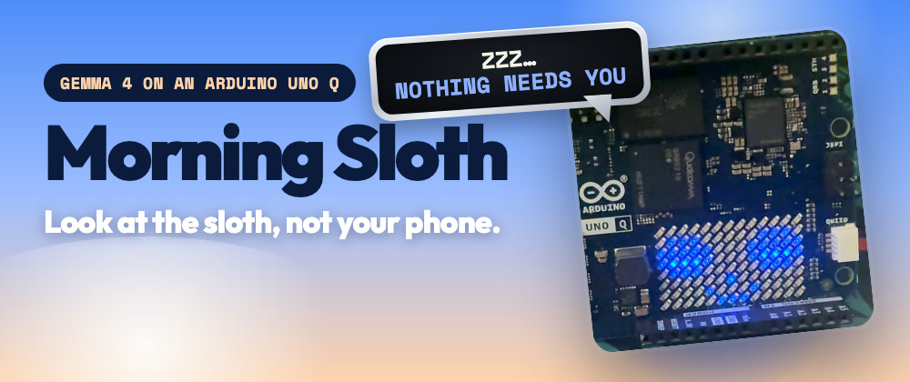
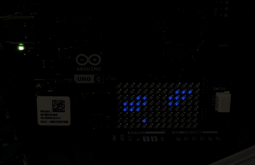
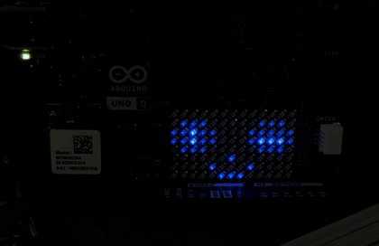
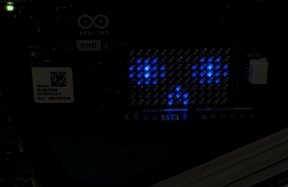
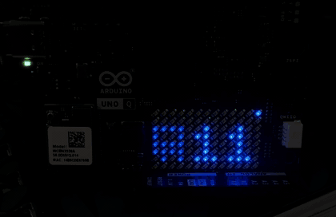
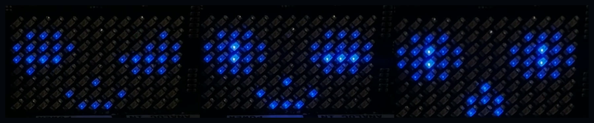
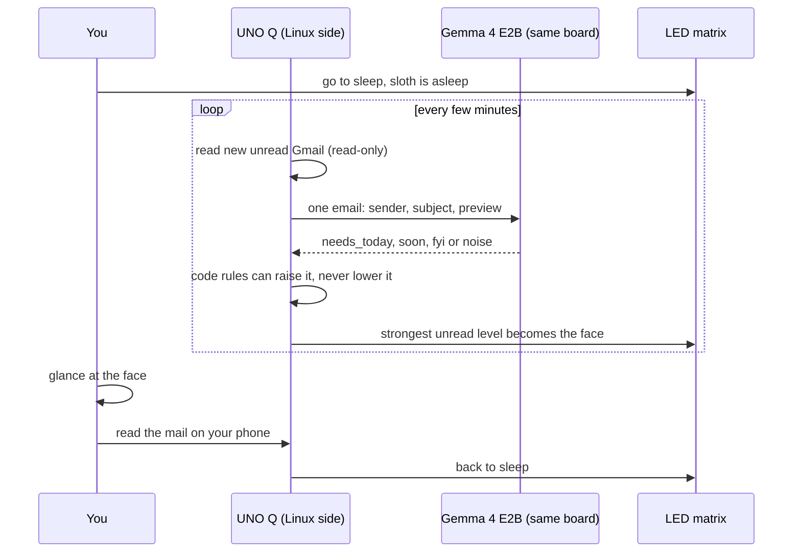
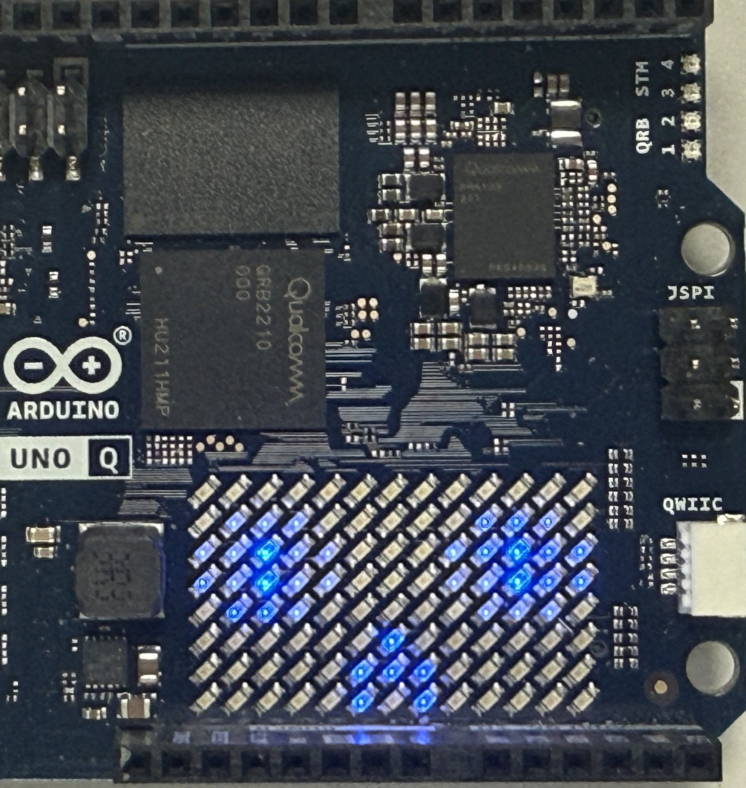
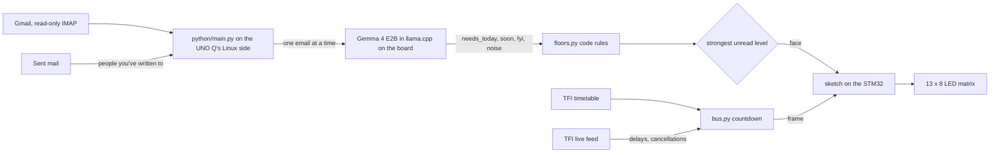

<p align="center">
  
</p>

<p align="center">
  <b>Look at the sloth, not your phone.</b> An Arduino UNO Q reads your Gmail overnight, open-weight <b>Gemma 4</b> decides on the board whether anything needs you, and one face on an LED matrix tells you.
</p>

<p align="center">
  <a href="#see-it-live">See it live</a> ·
  <a href="docs/DEMO.md">Demo guide</a> ·
  <a href="#setup">Setup</a> ·
  <a href="eval/RESULTS.md">Results</a> ·
  Built for the <a href="https://dev.to/challenges/hacktoberfest-week3-2026-10-19">DEV Hacktoberfest Open-Source AI Challenge, Week 3: Slow and Steady</a>
</p>

<p align="center">
  <a href="https://github.com/MuhammadMurtuzaHussain/morning-sloth/actions/workflows/tests.yml"></a>
  
  
  
  
</p>

# Morning Sloth 🦥

In plain words: you sleep late, you hate waking up to twenty notifications, and only one in four overnight emails actually matters. The sloth reads your inbox for you and shows **one of three faces**. You only pick up your phone when it's awake.

## See it live

Real footage of the board, no editing tricks. The face is the whole interface.

| Asleep | One eye open | Wide awake | Bus |
|---|---|---|---|
|  |  |  |  |
| Nothing needs you. Leave the phone. | Someone you know wrote, or a deadline is close. It can wait until the bus. | Needs you today: a failed payment, a parcel arriving, a leaked key. | Minutes until your bus. Only **9:00 to 13:00**. |

<p align="center">
  
</p>

- **Asleep, breathing slowly:** nothing needs you. Leave the phone where it is.
- **One eye open:** someone you've written to replied, or a deadline is close. It can wait until the bus.
- **Wide awake, blinking:** something needs you today, such as a failed payment, a parcel arriving, a leaked key or a recruiter asking for something.
- **Bus and a number (9:00 to 13:00 only):** minutes until the next 404 actually reaches Castlegar GAA, late buses and cancellations included. A dot in the top-right corner means the time is live. At any other hour the matrix shows just the sloth.

It never changes your mailbox. Read the mail on your phone and the sloth goes back to sleep by itself.

## Watch the AI work

One command shows the whole decision, live, in your terminal: the email arriving, Gemma 4 thinking on the board, the code rules, and the flag the sloth raises.

```bash
python3 tools/demo.py watch
```

```
00:31:02  📬  new email  Webinar starting in 10 minutes  from …@gmail.com
          …  Gemma is thinking on the board, 34s
00:31:36  🧠  Gemma 4 says  noise  (34s, on the board)
00:31:36  ⚖️   code rules raise it to  needs_today  because an event is starting now
00:31:36  🦥  FLAG → awake  WIDE AWAKE, it needs you today
```

Two ready-made emails make it change on cue. The steps are in the [demo guide](docs/DEMO.md).

## How a night goes



## Why it exists

<p align="center"></p>

I often wake up late. The moment I pick up my phone there are twenty notifications, most of them LinkedIn. Over three nights, **about 1 in 4 overnight emails needed me that morning**. Gmail's own Important label flagged a Trustpilot review request and a vendor's "[urgent]" incident notice, and it missed both of my failed electricity top-ups.

The sloth reads it all so I don't have to. I glance at it, and I only pick up the phone if it's awake.

## Why open matters here

This is my job search, my bills and my home address. Sorting it with a cloud model would mean sending all of that to someone else's server every night. Gemma 4 E2B runs **on the board itself**, so the mail never leaves the room. The only things that leave the board are the read-only IMAP connection to Gmail and, during bus hours, a download of Transport for Ireland's public live bus feed. That request carries an API key and nothing about you.

## How it works



**Gemma judges, code guarantees.** Gemma reads each email's sender, subject and preview and picks a level. Then plain code applies rules it can't override:

| Rule | Why |
|---|---|
| A bill or payment sender reporting a failure is always **needs_today** | Gemma called both PrepayPower failures "fyi" |
| A carrier saying it's delivering today is **needs_today** | Gemma called An Post's "delivering today" "fyi" |
| An event "starting in N minutes" is **needs_today** | Gemma called a webinar going live "noise" |
| Someone you've written to (from Sent) is at least **soon** | Gemma put a recruiter and a request for slides in "noise" |
| Google security alerts set off by connecting the sloth are capped at **fyi** | Turning on 2-Step Verification and creating the app password sends three alerts |

Rules can raise a level but never lower it. The one exception is the setup cap, which only applies to `accounts.google.com` alerts that name "Morning Sloth" or arrive within an hour of that alert.

## Results

Two hand-labelled sets of my real email: 91 from 19 to 22 October, which I used to design the rules, and **46 from 16 to 18 October held out**, which the rules were never tuned on. Borderline emails are left out of the scores. "Wake vs. quiet" asks only whether the sloth would wake (needs_today or soon) or stay asleep, because that's the call the matrix makes.

**Choosing the model** (91-email set, on the UNO Q):

| Model | Exact | Wake vs. quiet | Caught needs_today | Speed |
|---|---|---|---|---|
| Gemma 3 270M | 7% | 13% | 6/6, by calling everything urgent | 7.6 s/email |
| Gemma 3 1B | 12% | 21% | 2/6 | 39 s/email |
| **Gemma 4 E2B** | **69%** | **86%** | 1/6 | 34 s/email |

**What the device runs** (Gemma 4 E2B, prompt v2 with the security line, plus all the rules):

| | Exact | Wake vs. quiet | Caught needs_today | False wakes |
|---|---|---|---|---|
| Design set (85) | 74% | 88% | 5/6 | 7 |
| **Held-out set (42)** | **60%** | **98%** | **1/3 exact, 3/3 wake it** | **0** |

On the held-out days, the leaked-secrets alert from GitHub wakes it fully, and an event starting in an hour and a request for slides each open one eye. Ordinary sign-in notices stay quiet. The one held-out miss is an automated support-ticket follow-up.

The full numbers, misses included, are in [`eval/RESULTS.md`](eval/RESULTS.md). The labelled email itself stays private and is never committed.

## Setup

You need an Arduino UNO Q (the 4 GB one) on Wi-Fi, and `adb` on your computer (`brew install --cask android-platform-tools`).

1. **Model.** On the board, download Gemma 4 E2B (2.8 GB):
   ```bash
   adb shell 'mkdir -p ~/models && curl -fL -o ~/models/gemma-4-E2B-it-Q4_0.gguf https://huggingface.co/ggml-org/gemma-4-E2B-it-GGUF/resolve/main/gemma-4-E2B-it-Q4_0.gguf'
   ```
2. **Gemma server**, restarting with the board:
   ```bash
   adb shell 'docker run -d --name sloth-gemma --restart unless-stopped -p 8088:8080 -v /home/arduino/models:/models:ro ghcr.io/ggml-org/llama.cpp:server -m /models/gemma-4-E2B-it-Q4_0.gguf -c 2048 -t 4 --jinja --reasoning-budget 0 --host 0.0.0.0 --port 8080'
   ```
3. **App.** Copy `app/` to the board, start it and make it the default app:
   ```bash
   adb push app /home/arduino/ArduinoApps/morning-sloth
   adb shell 'TMPDIR=/tmp arduino-app-cli app start ~/ArduinoApps/morning-sloth && TMPDIR=/tmp arduino-app-cli properties set default /home/arduino/ArduinoApps/morning-sloth'
   ```
   `TMPDIR=/tmp` matters, because `adb shell` sets an Android temp folder that breaks the build.
4. **Gmail.** Turn on 2-Step Verification, create an app password at myaccount.google.com/apppasswords, then run this. It asks for the password without echoing it and keeps only the 16 letters:
   ```bash
   adb shell -t 'read -r -s -p "Gmail app password: " P; echo; P=$(printf %s "$P" | tr -cd "a-zA-Z"); echo "length: ${#P}"; [ ${#P} -eq 16 ] || exit 1; printf "GMAIL_USER=you@gmail.com\nGMAIL_APP_PASSWORD=%s\nQUIET_FROM=02:00\nWAKE_AT=06:00\n" "$P" > ~/ArduinoApps/morning-sloth/secrets.env; chmod 600 ~/ArduinoApps/morning-sloth/secrets.env; TMPDIR=/tmp arduino-app-cli app restart ~/ArduinoApps/morning-sloth'
   ```

### Settings (`secrets.env` on the board)

| Setting | Default | Meaning |
|---|---|---|
| `QUIET_FROM`, `WAKE_AT` | `02:00`, `06:00` | Matrix stays dark in between |
| `POLL_MINUTES` | `5` | How often to check Gmail |
| `BUS_FROM`, `BUS_TO` | `09:00`, `13:00` | The only hours the bus countdown shows; outside them it's just the sloth |
| `BUS_WALK_MINUTES` | `0` | Count down to when you must leave, not to the bus |
| `EXTRA_CONTACTS` | none | Comma-separated addresses that always count as people you've written to |
| `TFI_API_KEY` | none | Live bus times; without it the countdown uses the timetable |
| `LIVE_MINUTES` | `2` | How often to fetch the live feed during bus hours |

### Live bus times

Get a free key at [developer.nationaltransport.ie](https://developer.nationaltransport.ie): sign up, subscribe to the GTFS-Realtime API and copy the primary key. Save it on the board without it showing on screen:
```bash
adb shell -t 'read -r -s -p "TFI API key: " K; echo; cd ~/ArduinoApps/morning-sloth && sed -i "/^TFI_API_KEY=/d" secrets.env && echo "TFI_API_KEY=$K" >> secrets.env && TMPDIR=/tmp arduino-app-cli app restart ~/ArduinoApps/morning-sloth'
```
Every two minutes during bus hours (9:00 to 13:00) the board downloads the national feed (about 500 KB as protobuf, read by `live.py` with no extra libraries). It picks out the 404's trips at your stop and applies each bus's delay, drops cancelled ones and adds extra ones. If the feed is down or more than 10 minutes old, the countdown falls back to the timetable and the corner dot goes out.

### Your own bus

The timetable comes from Transport for Ireland's public GTFS feed and needs no account. Live times match it by trip ID, so cut it again whenever TFI republishes the feed. To use a different route or stop:
```bash
curl -LO https://www.transportforireland.ie/transitData/Data/GTFS_Bus_Eireann.zip && unzip GTFS_Bus_Eireann.zip -d gtfs
python3 tools/bus_timetable.py gtfs 404 8460B5243201 > app/bus_timetable.json
```
`8460B5243201` is Castlegar GAA towards Eyre Square and Newcastle. The stop across the road, towards Oranmore, is `8460B5241801`. The feed is valid until the date in `valid_until`, so regenerate it after that.

## Tests

```bash
python3 -m unittest discover tests
```
40 tests (run on every push by the [Tests workflow](.github/workflows/tests.yml)) cover the rules, the setup cap, the 9:00 to 13:00 bus window, Irish summer time (including this Sunday's clock change), the bus timetable (including the October bank holiday), the live feed (protobuf decoding, late, cancelled, skipped and extra buses), the countdown frames and email previews. The model benchmark runs on the board: `python3 eval/bench.py <labelled.jsonl> <out dir> device`.

## Honest limits

- **Live times are only as good as the feed.** Transport for Ireland's feed sometimes reports a bus late at an earlier stop and nothing at yours. The sloth then carries that delay forward, as the GTFS-Realtime spec says, which can be a few minutes off.
- **Security alerts are hard.** Gemma can't tell a sign-in you made from one you didn't. In testing it left ordinary "new sign-in" notices quiet, which is right almost every time, but it means a real intruder's sign-in notice might not wake it either. Leaked-key alerts do wake it.
- **The rules were written after seeing the first set.** That's why the held-out set exists, and why its numbers are the ones to trust.
- **It's slow, by design.** About 35 seconds per email on the board's CPU. Ten emails overnight take six minutes, while you're asleep anyway.

## Files

```
app/                 the UNO Q app (App Lab layout)
  python/main.py     polling loop, quiet hours, what the matrix shows
  python/triage.py   the Gemma prompt and request (shared with the eval)
  python/floors.py   the code rules
  python/gmail.py    read-only IMAP: EXAMINE and BODY.PEEK only
  python/bus.py      next departure from the GTFS cut
  python/live.py     live delays and cancellations from the TFI realtime feed
  python/glyphs.py   bus countdown frames
  python/irishtime.py Irish time without tzdata
  sketch/            STM32 sketch: faces, breathing, blinking
  bus_timetable.json 404 at Castlegar GAA, cut from the TFI feed
tools/demo.py        live terminal view and demo triggers
tools/trigger.py     runs on the board to email itself a demo email
docs/DEMO.md         how to film the sloth changing faces
.github/workflows/   unit tests on every push
tools/faces.py       the faces as ASCII art, generates sketch/faces.h
tools/bus_timetable.py  cuts the GTFS feed down to one route at one stop
eval/                benchmark and scoring scripts (data stays private)
tests/               unit tests
```
